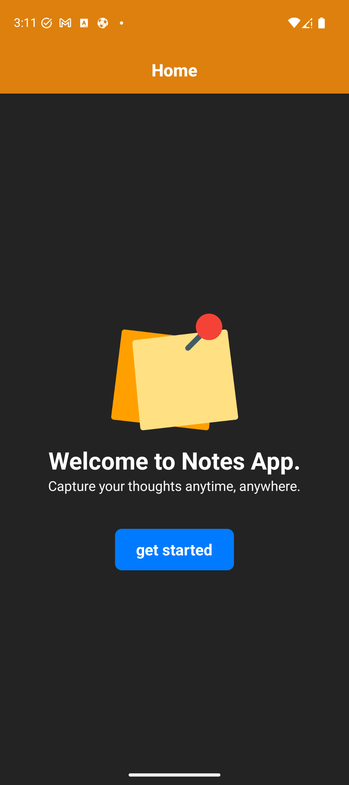
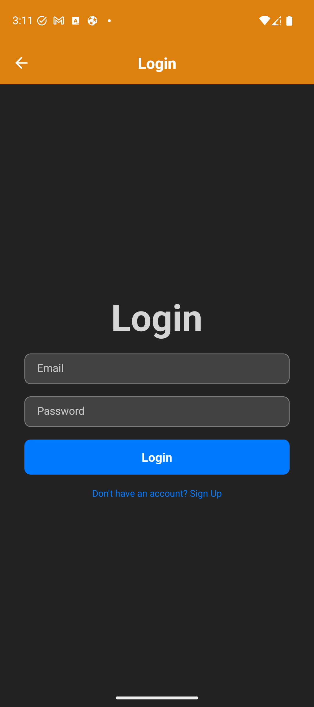
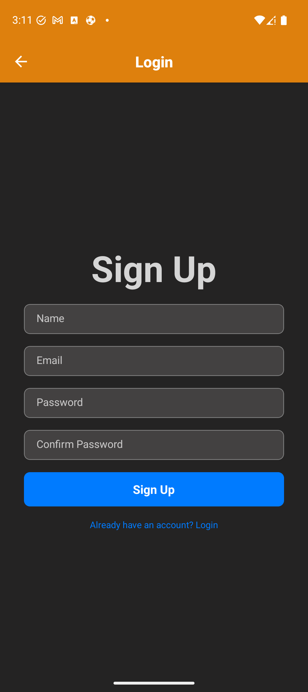
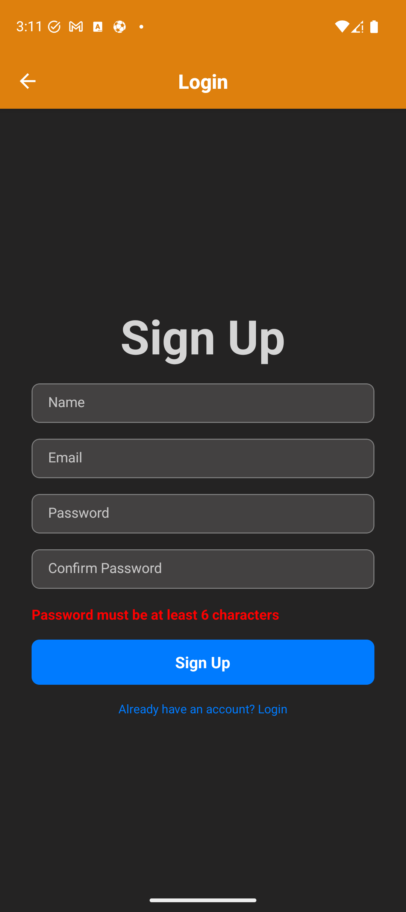
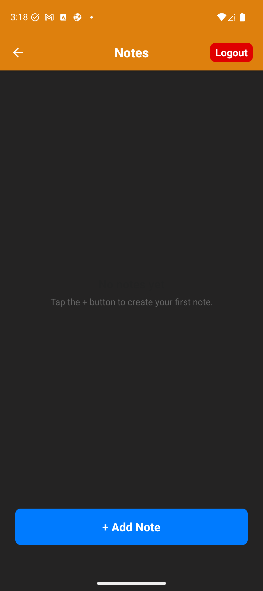
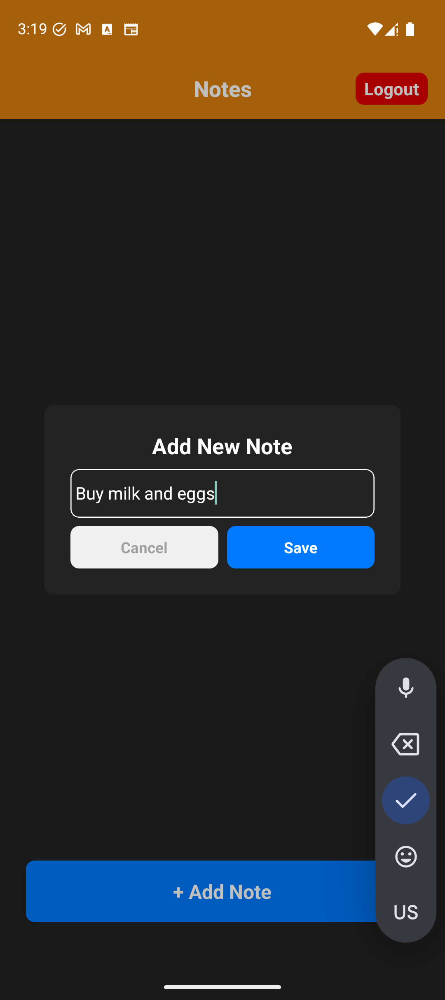
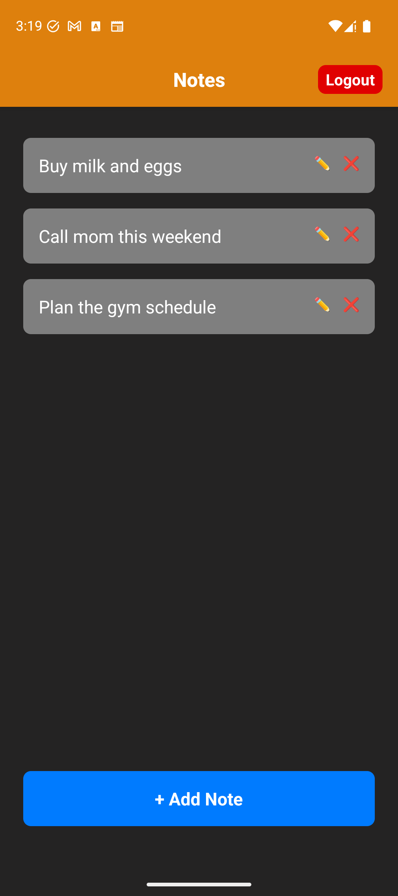
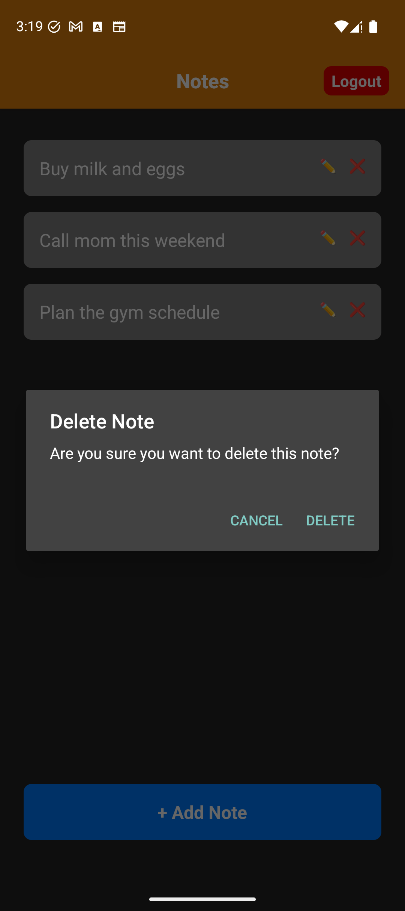

# 📝 Notes App

A cross-platform notes app built with **React Native**, **Expo** and **TypeScript**, backed by **Appwrite**.
Sign up, log in, and keep your notes synced to the cloud: create, edit inline, and delete them from your phone.


## 📱 Screenshots

Captured from the Android emulator (Pixel 9).

### Onboarding & auth

| Home | Login | Sign Up | Form validation |
|:---:|:---:|:---:|:---:|
|  |  |  |  |

### Notes

| Empty state | Add a note | Your notes | Inline edit | Delete confirmation |
|:---:|:---:|:---:|:---:|:---:|
|  |  |  |  |  |

## ✨ Features

- **Authentication**: email/password sign up and login through Appwrite, with the session restored on app launch.
- **Route protection**: signed-out users are redirected to the login screen, and signed-in users skip the welcome screen and go straight to their notes.
- **Notes CRUD**: add notes from a modal, edit them inline (✏️ / 💾), and delete them with a confirmation dialog.
- **Client-side validation**: password length and password-confirmation checks with inline error messages.
- **Error feedback**: toast notifications (`react-native-toast-message`) when an update or delete fails, after which the list re-syncs from the server.
- **Dark UI** with a consistent orange/blue palette.

## 🧱 Tech stack

| Area | Choice |
|---|---|
| Framework | React Native 0.81 + React 19, New Architecture enabled |
| Tooling | Expo SDK 54, EAS build config, Expo Dev Client |
| Navigation | [Expo Router](https://docs.expo.dev/router/introduction/) (file-based routing, typed routes) |
| Language | TypeScript |
| Backend | [Appwrite](https://appwrite.io) (Auth + Databases) via `react-native-appwrite` |
| Performance | React Compiler enabled |
| Feedback | `react-native-toast-message` |

## 🏗️ Architecture

The notes feature follows a layered, clean-architecture style so the UI never talks to Appwrite directly:

```
app/                          # Expo Router screens (file-based routes)
├── _layout.tsx               # Root stack, header styling, logout button, AuthContextProvider
├── index.tsx                 # Welcome screen
├── auth/index.tsx            # Login / Sign up
└── notes/index.tsx           # Notes screen

src/
├── auth/
│   ├── authContext.js        # React context: user, loading, login, register, logout
│   └── authService.ts        # Appwrite account calls
├── core/data/remote/appwrite # Appwrite client + database wrapper
└── notes/
    ├── domain/               # Note type + NotesDataSource interface (no framework deps)
    ├── data/                 # NotesRepo + remote data source + DTO mapping
    └── presentation/         # NotesList, NoteItem, AddNoteModal
```

**Data flow:** `Screen → NotesRepo → NotesDataSource (interface) → RemoteNoteDataSource → Appwrite`.
Because the screen depends on the `NotesDataSource` interface, a local or offline data source can be added without touching the UI.

## 🚀 Getting started

### Prerequisites

- Node.js 20+
- An [Appwrite](https://appwrite.io) project with a database and a notes collection
- Android Studio emulator, an iOS simulator, or a physical device

### 1. Install

```bash
git clone <your-repo-url>
cd notes-app
npm install
```

### 2. Configure environment

Create a `.env` file in the project root (it is git-ignored):

```env
EXPO_PUBLIC_APPWRITE_PROJECT_ID=
EXPO_PUBLIC_APPWRITE_PROJECT_NAME=
EXPO_PUBLIC_APPWRITE_ENDPOINT=
EXPO_PUBLIC_APPWRITE_DATABASE_ID=
EXPO_PUBLIC_APPWRITE_DB_TABLE_NOTES_ID=
EXPO_PUBLIC_APPWRITE_COLLECTION_ID=
EXPO_PUBLIC_APPWRITE_BUNDLE_ID=
EXPO_PUBLIC_APPWRITE_PACKAGE_NAME=
```

The notes collection stores these fields: `userId`, `content`, `createdDate`, `lastUpdatedDate`, `isArchived`.

### 3. Run

```bash
npx expo start --android   # or press "a" in the Expo terminal
npx expo start --ios       # or press "i"
```

This project uses a development client (`expo-dev-client`), so build it once with `npm run android` or `npm run ios`, then use `npx expo start` for day-to-day development.

## 📜 Scripts

| Command | What it does |
|---|---|
| `npm start` | Start the Metro bundler |
| `npm run android` | Build and run on Android |
| `npm run ios` | Build and run on iOS |
| `npm run web` | Run in the browser |
| `npm run lint` | Lint with ESLint (`eslint-config-expo`) |

## 🗺️ Roadmap

- [ ] Archive notes (the data-source method already exists)
- [ ] Search and sort
- [ ] Offline cache and sync
- [ ] Light theme

## 🙋 About

Built by **Serag** as a hands-on React Native project covering routing, auth flows, layered architecture and a real backend.
